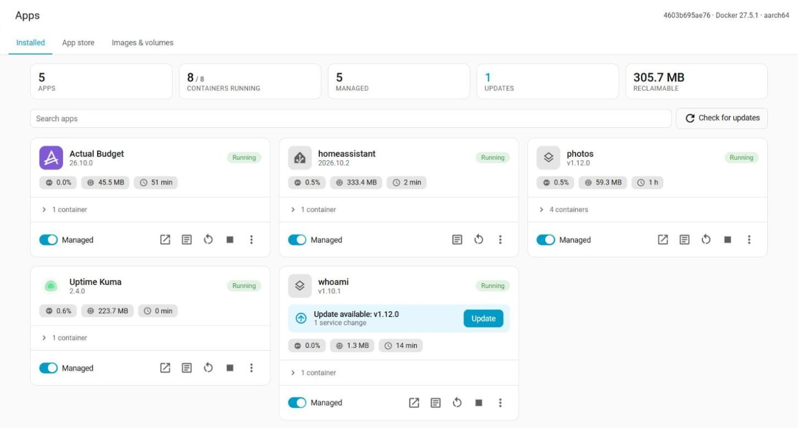
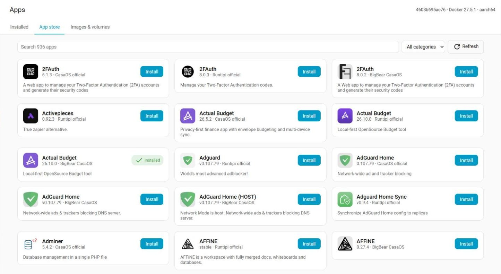
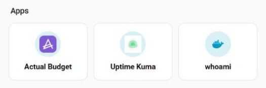

<!-- cspell:words tecnativa -->
# Docker Apps for Home Assistant

[](https://github.com/custom-components/hacs)
[](https://github.com/rosenkolev/home-assistant-docker-integration/releases)
[](https://github.com/rosenkolev/home-assistant-docker-integration/actions/workflows/hassfest.yml)
[](https://github.com/rosenkolev/home-assistant-docker-integration/actions/workflows/test.yml)
[](https://github.com/rosenkolev/home-assistant-docker-integration/actions/workflows/test.yml)

Manage your Docker apps from Home Assistant, like the Apps page of Home Assistant OS or a NAS app store. Made for **Home Assistant Container** installs.



## Features

* **Apps panel:** every app (compose project) with status, health, CPU, memory and uptime. Start, stop, restart, open and remove apps.
* **Logs on demand:** live logs per container, only while you look at them.
* **Updates:** in **Settings > Updates**. A multi-container app (Immich, ...) is updated as **one package**, with automatic rollback if it doesn't come up healthy. Databases are not updated by surprise.
* **App store:** install apps from **CasaOS** and **Runtipi** repositories. Secrets are generated for you.
* **Clean-up:** prune unused containers, images, volumes, networks and build cache.
* **App launcher card:** a dashboard card that opens your apps.
* **Few entities:** about 5 per app, no matter how many containers it has.
* **Light:** runs in Home Assistant in Python, on the Docker Engine API. No extra container, no `docker` CLI.



> [!WARNING]
> Early version. Try it on a copy of your setup first.

## Requirements

* Home Assistant **2026.9** or newer, installed as a container.
* The Docker socket and your apps folders mounted into the Home Assistant container, **at the same path as on the host**:

  ```yaml
  services:
    homeassistant:
      image: ghcr.io/home-assistant/home-assistant:stable
      network_mode: host
      volumes:
        - ./config:/config
        - /var/run/docker.sock:/var/run/docker.sock
        - /opt/docker-apps:/opt/docker-apps            # apps (compose projects)
        - /opt/docker-apps-data:/opt/docker-apps-data  # data of store apps
  ```

## Installation

1. In HACS, open **Custom repositories** and add `https://github.com/rosenkolev/home-assistant-docker-integration` as **Integration**.
1. Install **Docker Apps** and restart Home Assistant.
1. Go to **Settings > Devices & services > Add integration > Docker Apps**.

Manual: copy `custom_components/docker_apps` into your `config/custom_components` folder and restart.

## Getting started

1. Open **Apps** in the sidebar. Your existing compose projects show up as **unmanaged**: monitored, but never changed.
1. Turn **Managed** on for an app to get its updates in **Settings > Updates**.
1. Add an app store: **Settings > Devices & services > Docker Apps > Add app store repository**, then install apps from the **App store** tab.
1. Add the **Docker Apps** card to a dashboard to open your apps with one tap:

   

## Notes

* **Security:** access to the Docker socket is full control of the host. The panel and all actions are for admins only. Use read-only mode or a socket proxy such as [tecnativa/docker-socket-proxy](https://github.com/Tecnativa/docker-socket-proxy) to limit it.
* **Supervised:** Home Assistant Supervised doesn't give Home Assistant the Docker socket, and the Supervisor marks a system as unsupported when it runs other containers.
* **Your files:** a managed app's compose files change only when you install an update or a rollback. Backups are kept in `<app>/.docker-apps/history/`.

## More

* [Reference](./docs/REFERENCE.md): configuration, entities, update rules, app stores, card options, actions and events.
* [Contributing](./CONTRIBUTING.md)
